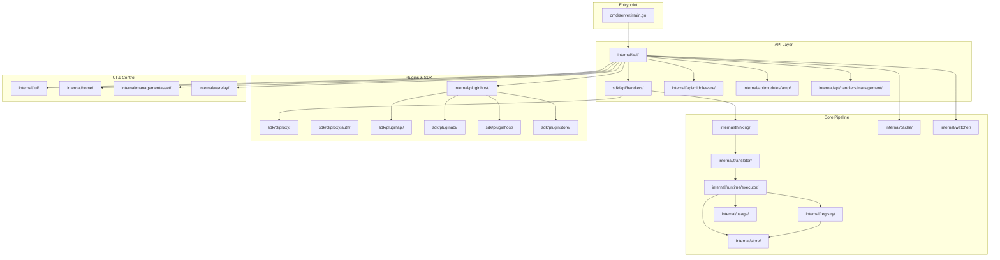

# CLIProxyAPI Code Graph & Architectural Map

This document provides a comprehensive, high-level code graph and architectural map for the CLIProxyAPI project. It serves as a persistent structural guide for AI agents and developers to understand, extend, and maintain the codebase with minimal file reads.

---

## A. Visual Architecture

### Mermaid.js Diagram



### ASCII Overview

```
[cmd/server/main.go]
    |
    v
[internal/api/]
    |-- routes, middleware, modules
    |---> [sdk/api/handlers/]
    |---> [internal/api/middleware/]
    |---> [internal/api/modules/amp/]
    |---> [internal/api/handlers/management/]
    |
    v
[internal/thinking/] --> [internal/translator/] --> [internal/runtime/executor/]
    |                       |                           |
    v                       v                           v
[internal/registry/] <---- [internal/store/] <-------- [internal/usage/]
    |
    v
[internal/cache/], [internal/watcher/], [internal/wsrelay/], [internal/tui/], [internal/managementasset/]
    |
    v
[sdk/cliproxy/], [sdk/pluginapi/], [sdk/pluginabi/], [sdk/pluginhost/], [sdk/pluginstore/]
```

---

## B. Structured Code Graph Index

### [cmd/server/main.go]
- **Role:** Main entrypoint; parses flags, loads config, starts server or CLI modes.
- **Exports:** `main()`, `init()`, build version variables
- **Dependencies:** internal/api, internal/config, internal/logging, internal/registry, internal/store, sdk/cliproxy/auth
- **Incoming References:** CLI invocation, Docker entrypoint, build/run scripts
- **Key Functions/Logic:**
  - `main()`: Parses CLI flags, loads config, dispatches to server or CLI subcommands
  - `init()`: Sets up base logger and build info

### [internal/api/server.go]
- **Role:** HTTP API server (Gin), config hot-reload, handler/middleware wiring, TLS support.
- **Exports:** `Server` struct, server lifecycle methods
- **Dependencies:** gin-gonic/gin, internal/api/middleware, sdk/api/handlers, internal/config
- **Incoming References:** cmd/server/main.go, test/
- **Key Functions/Logic:** Server startup, shutdown, config reload, request logging, connection multiplexing

### [internal/api/]
- **Role:** Gin HTTP API layer with routes, middleware, and modules.
- **Exports:** Route registration, middleware chain, Amp module integration
- **Dependencies:** gin-gonic/gin, internal/api/middleware, sdk/api/handlers
- **Key Functions/Logic:** Route registration for OpenAI, Claude, Gemini, Codex, management API

### [internal/api/modules/amp/]
- **Role:** Amp integration module providing Amp-style routes and reverse proxy.

### [internal/api/handlers/management/]
- **Role:** Management API handlers including provider OAuth flows, config management.
- **Key Functions/Logic:** OAuth login flows, quota fetching, config CRUD
- **Note:** Endpoints under `/v0/management` are deprecated

### [internal/thinking/]
- **Role:** Main thinking/reasoning pipeline; centralizes request normalization.
- **Exports:** `ApplyThinking()`, `ThinkingConfig`, validation/normalization helpers, `ProviderApplier`
- **Dependencies:** internal/translator, internal/runtime/executor
- **Incoming References:** sdk/api/handlers, internal/api
- **Key Functions/Logic:**
  - `ApplyThinking()`: Parses suffixes, normalizes to canonical `ThinkingConfig`, validates, applies provider-specific output
  - **CRITICAL:** Do not break the "canonical representation → per-provider translation" architecture

### [internal/translator/]
- **Role:** Provider protocol translators and shared utilities.
- **Exports:** Protocol translation functions, registry, common utilities
- **Dependencies:** internal/runtime/executor, internal/thinking
- **Key Functions/Logic:** Translate canonical requests to provider-specific payloads
- **CRITICAL:** Do not make standalone changes; only modify as part of broader changes

### [internal/runtime/executor/]
- **Role:** Per-provider runtime executors (OpenAI, Claude, Gemini, Codex WebSocket, etc.).
- **Exports:** Executor structs, execution logic per provider
- **Dependencies:** internal/translator, internal/registry, internal/store, internal/usage
- **Key Functions/Logic:** Executes requests, manages streaming, retries, failover, WebSocket connections
- **Helpers:** Place helper files under `internal/runtime/executor/helps/`
- **CRITICAL:** Payload configuration MUST be the final semantic barrier before sending requests

### [internal/registry/]
- **Role:** Model registry and remote updater; manages model catalog updates.
- **Exports:** Registry management, `StartModelsUpdater()`, model catalog access
- **Dependencies:** internal/store, internal/thinking
- **Key Functions/Logic:** Model catalog management, remote updates (disabled with `--local-model`)

### [internal/store/]
- **Role:** Storage backends (file default; optional Postgres, git, object store) and secret resolution.
- **Exports:** Storage interfaces, secret management, credential persistence
- **Dependencies:** Database drivers (pgx/v5, go-git, minio-go)
- **Key Functions/Logic:** File-based default, environment-driven backend selection

### [sdk/cliproxy/] & [sdk/cliproxy/auth/]
- **Role:** Embeddable SDK entry and per-provider auth logic with cooldown/quota signals.
- **Exports:** SDK service, builder pattern, auth conductor, credential refreshers
- **Dependencies:** internal/api, internal/thinking, internal/store, internal/registry

### [sdk/api/handlers/]
- **Role:** Core API handlers for processing requests (OpenAI, Claude, Gemini endpoints).
- **Exports:** Handler interfaces and implementations
- **Dependencies:** internal/thinking, sdk/cliproxy, sdk/cliproxy/auth

### [sdk/pluginapi/], [sdk/pluginabi/], [sdk/pluginhost/], [sdk/pluginstore/]
- **Role:** Plugin host RPC, quota/auth provider plugins, plugin store, ABI definitions.

### [test/]
- **Role:** Cross-module integration and regression tests.
- **Key Tests:** thinking conversion, Codex failover, stream disconnect, usage logging

---

## C. Data Flow Patterns & Architectural Invariants

### Primary Data Flow (Request Lifecycle)

1. **Client Request** → HTTP API route (`internal/api/`) → Handler (`sdk/api/handlers/`)
2. **Handler** → Resolves model, selects credential via auth conductor (`sdk/cliproxy/auth/`)
3. **Thinking Pipeline** → Normalizes request to canonical `ThinkingConfig` (`internal/thinking/`)
4. **Translator** → Converts canonical config to provider-specific payload (`internal/translator/`)
5. **Executor** → Sends to upstream provider, manages retries/streaming/failover (`internal/runtime/executor/`)
6. **Registry/Store** → Updates model registry, persists usage/quota signals
7. **Response** → Streams back to client; usage/quota signals update cooldowns and registry

### Architectural Invariants

- **Canonical Representation:** All requests normalized to canonical `ThinkingConfig` before translation
- **Payload Configuration as Final Barrier:** User payload rules applied exactly once, just before sending upstream
- **No Timeout After Upstream Connection:** Timeouts only during credential acquisition
- **No Logging of Secrets:** Never log/persist secrets, tokens, API keys in plaintext
- **Plugin Isolation:** Plugins interact only via defined SDK interfaces
- **Config Hot-Reload:** Changes to `config.yaml` trigger hot-reload without restart
- **Storage Backend Abstraction:** File-based default; optional backends via environment variables

---

## D. Gotchas & Pitfalls

### Critical "Do NOT" Rules

- **Do NOT break canonical → per-provider translation flow** in `internal/thinking/` and `internal/translator/`
- **Do NOT make standalone changes to `internal/translator/`** unless part of broader changes
- **Do NOT set network timeouts after upstream connection** except credential acquisition
- **Do NOT log secrets/tokens** in any form
- **Do NOT use `log.Fatal`/`log.Fatalf`** in request paths; always return errors
- **Do NOT panic in HTTP handlers**; prefer logged errors and HTTP status codes
- **Do NOT modify user payload after applying payload configuration rules**
- **Do NOT modify `/v0/management` endpoints** unless fixing compilation errors
- **Do NOT use wall-clock `time.Sleep`** in TTL/expiration tests; use mock clocks

### Fragile Dependencies

- **Fork-Specific Fixes:** Must be preserved during upstream merges (see `docs/MERGE-PRESERVATION-fork-fixes.md`)
- **Executor Helpers:** Place under `internal/runtime/executor/helps/`, not in root
- **Credential Rotation:** Works for HTTP; WebSocket requires client replay on failure

---


## E. Testing Commands & Execution Workflows

### Quick Commands

```bash
# Format code (REQUIRED after Go changes)
gofmt -w .

# Build server
go build -o cli-proxy-api ./cmd/server

# Run dev server
go run ./cmd/server

# Run all tests
go test ./...

# Run single test
go test -v -run TestName ./path/to/pkg

# Verify compile (REQUIRED after changes)
go build -o test-output ./cmd/server && rm test-output
```

### Common Flags

- `--config <path>`: Specify config file path
- `--tui`: Launch terminal UI mode
- `--standalone`: Standalone mode (no CLIProxyAPIHome integration)
- `--local-model`: Use embedded model catalogs (disable remote updates)
- `--no-browser`: Skip opening browser for OAuth flows
- `--oauth-callback-port <port>`: Custom OAuth callback port

### Configuration

- **Default config:** `config.yaml` (template: `config.example.yaml`)
- **Environment:** `.env` is auto-loaded from working directory
- **Auth material:** Defaults under `auths/` directory
- **Storage backends:** File-based default; optional Postgres/git/object store via environment variables

---

## F. Quick Reference: Key Files by Task

| Task                                 | Key Files/Dirs to Edit                                                                 |
|---------------------------------------|---------------------------------------------------------------------------------------|
| **Add new API endpoint**              | `internal/api/`, `sdk/api/handlers/`                                                  |
| **Modify provider logic**             | `internal/runtime/executor/`, `internal/translator/`, `internal/thinking/`            |
| **Change model registry**             | `internal/registry/`, `internal/store/`                                               |
| **Adjust config or hot-reload**       | `internal/watcher/`, `internal/api/server.go`, `config.yaml`                          |
| **Add/modify plugin**                 | `internal/pluginhost/`, `sdk/pluginapi/`, `sdk/pluginabi/`                            |
| **Change TUI or management UI**       | `internal/tui/`, `frontend/`, `internal/managementasset/`                             |
| **Update integration tests**          | `test/`, relevant `internal/` and `sdk/` modules                                      |
| **Change OAuth/auth logic**           | `sdk/cliproxy/auth/`, `internal/api/handlers/management/`, `auths/`                   |
| **Change storage backend**            | `internal/store/`, `config.yaml`, environment variables                               |
| **Update documentation**              | `README.md`, `ARCHITECTURE.md`, `AGENTS.md`, `docs/`, `CHANGELOG.md`                  |
| **Modify thinking/reasoning**         | `internal/thinking/`, `internal/translator/`, `internal/runtime/executor/`            |
| **Add new provider support**          | `internal/runtime/executor/`, `internal/translator/`, `sdk/cliproxy/auth/`            |
| **Change request/response streaming** | `internal/runtime/executor/`, `sdk/api/handlers/`, `internal/wsrelay/`                |
| **Modify quota/cooldown logic**       | `sdk/cliproxy/auth/`, `internal/usage/`, `internal/registry/`                         |

---

## G. Maintenance Notes

- **This code graph is authoritative** for high-level architectural understanding and navigation
- **Update this file** when major architectural changes occur (new modules, changed data flows, new invariants)
- **Reference this file first** before deep-diving into specific modules to minimize unnecessary file reads
- **Keep synchronized with:** `ARCHITECTURE.md`, `AGENTS.md`, `CONTRIBUTING.md`

---

**Last Updated:** 2026-10-14  
**Version:** 1.0

